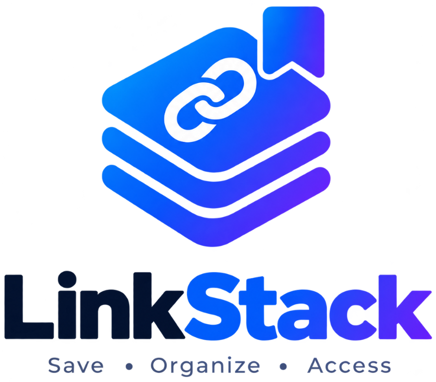

# LinkStack

<p align="center">
  
</p>

<p align="center">
  A minimalist developer bookmark and resource manager organizing web links into Packages and Sections with anti-SSRF protection and keyboard-first navigation.
</p>

<p align="center">
  <a href="https://www.typescriptlang.org/"></a>
  <a href="https://nextjs.org/"></a>
  <a href="https://www.prisma.io/"></a>
  <a href="https://tailwindcss.com/"></a>
  <a href="LICENSE"></a>
</p>

<p align="center">
  <strong>English</strong> | <a href="README.vi.md">Tiếng Việt</a>
</p>

---

## Overview

Modern web workflows generate hundreds of fragmented URLs across browsers, chat channels, and issue trackers. Existing bookmark managers either flatten links into unstructured lists or enforce rigid single-folder taxonomies.

LinkStack organizes links into a **3-tier hierarchy**: **Package → Section → URL**. You can group resources by repository, project, or domain, save links directly into a Package root, or partition them into specialized Sections.

### Core Capabilities

- **3-Tier Hierarchy**: `Package` → `Section` → `URLs`. Move links between sections, preserve orphaned links safely, and customize package colors and icons.
- **SSRF-Protected Metadata Ingestion**: Automatic scraping of page title, description, and high-resolution favicons with strict IP validation that blocks private networks, loopbacks, and cloud metadata endpoints.
- **Multi-Provider Authentication**: Email/password credentials authentication with bcrypt hashing, plus Google and GitHub OAuth with automatic account linking.
- **Instant Command Palette (`Cmd/Ctrl + K`)**: Keyboard-driven navigation and search across packages, sections, URLs, and tags.
- **Netscape HTML & JSON Migration**: Import bookmarks from Chrome, Firefox, Safari, Edge, and Brave with pre-import duplicate link detection; export anytime.
- **Batch Link Operations**: Multi-select bookmarks to move, tag, favorite, or delete in bulk.
- **Integrated Markdown Notes & Tasks**: Save contextual notes and actionable tasks alongside bookmarked resources.
- **Tenant Isolation**: Server-enforced ownership checks on every database mutation preventing IDOR vulnerabilities.

---

## Quick Start

**Prerequisites:**
- **Node.js**: v18.17+ or v20+ / v22+
- **PostgreSQL**: v14+ running locally or in Docker

### 1. Clone & Install

```bash
git clone https://github.com/harry-leon/LinkStack.git
cd LinkStack
npm install
```

### 2. Configure Environment

Copy the example environment configuration:

```bash
cp .env.example .env
```

Ensure `.env` contains your PostgreSQL connection string:

```env
DATABASE_URL="postgresql://postgres@localhost:5432/linkstack_db?schema=public"
NEXTAUTH_URL="http://localhost:3000"
NEXTAUTH_SECRET="linkstack-super-secret-development-key-2026-secure-token"
```

### 3. Initialize Database

Push the relational schema to PostgreSQL:

```bash
npx prisma db push
```

### 4. Start Development Server

```bash
npm run dev
```

Expected output:
```text
  ▲ Next.js 14.2.35
  - Local:        http://localhost:3000
  - Environments: .env

 ✓ Ready in 1.8s
```

Open [http://localhost:3000](http://localhost:3000) in your browser.

**Demo Credentials**:
- **Email**: `demo@linkstack.app`
- **Password**: `Password123!`

---

## Configuration

| Variable | Required | Default | Description |
|---|---|---|---|
| `DATABASE_URL` | yes | - | PostgreSQL connection URI |
| `NEXTAUTH_URL` | yes | `http://localhost:3000` | Canonical application base URL |
| `NEXTAUTH_SECRET` | yes | - | 32+ character secret for JWT session encryption |
| `GOOGLE_CLIENT_ID` | no | - | Google OAuth Client ID |
| `GOOGLE_CLIENT_SECRET` | no | - | Google OAuth Client Secret |
| `GITHUB_ID` | no | - | GitHub OAuth Application Client ID |
| `GITHUB_SECRET` | no | - | GitHub OAuth Application Client Secret |
| `CRON_SECRET` | no | - | Bearer token authenticating `/api/cron/reminders` |
| `STORAGE_ENDPOINT` | no | - | S3-compatible object storage endpoint for note attachments |
| `STORAGE_ACCESS_KEY_ID` | no | - | S3 Access Key ID |
| `STORAGE_SECRET_ACCESS_KEY` | no | - | S3 Secret Access Key |
| `STORAGE_BUCKET` | no | - | S3 Bucket name |

---

## Data Model & Hierarchy

```text
User (Authentication & Quotas)
  ├── Account (OAuth Provider Links)
  ├── Note (Markdown Content & Attachments)
  ├── Task (To-Dos & Reminders)
  ├── Tag (Categorical Labels)
  └── Package (id, name, color, icon, isFavorite, sortOrder)
        ├── Section (id, name, icon, sortOrder)
        │     └── Url (id, url, title, description, faviconUrl, isFavorite, tags)
        └── Url (Direct Package Links without a Section)
```

- **Section Deletion Safeguard**: Deleting a section allows either deleting nested links or safely preserving them at the Package root (`sectionId: null`).
- **Duplicate Detection**: LinkStack evaluates canonical URLs before saving, notifying you if a link already exists in another package or section.

---

## Security Architecture

1. **Anti-SSRF Safe Fetcher (`lib/ssrf.ts`)**:
   - Only `http:` and `https:` schemes are accepted.
   - Hostnames are resolved to IP addresses and verified against private IPv4 ranges (`10.0.0.0/8`, `172.16.0.0/12`, `192.168.0.0/16`), IPv6 loopback (`::1`), link-local (`169.254.0.0/16`), and cloud metadata services (`169.254.169.254`).
   - Requests enforce a 4-second timeout and 512 KB payload size ceiling.
2. **Server-Side Authorization**:
   - Every mutation and query validates `userId` against the server-verified session token.
3. **Password Security**:
   - Passwords hashed with bcrypt at 12 salt rounds following OWASP recommendations.

---

## Project Structure

```text
LinkStack/
├── app/                      # Next.js App Router pages and API routes
│   ├── api/                  # REST route handlers (packages, sections, urls, auth)
│   ├── login/ & register/    # Authentication views with Google & GitHub OAuth
│   ├── packages/             # Package overview and package detail views
│   ├── urls/                 # All URLs searchable directory
│   ├── notes/ & tasks/       # Markdown notes and task management
│   ├── import-export/        # Netscape HTML and JSON migration tools
│   ├── layout.tsx            # Root layout with theme, session, and metadata icons
│   └── manifest.ts           # Web app manifest for PWA installation
├── components/
│   ├── landing/              # Landing page view
│   ├── layout/               # Sidebar, TopHeader, AppShell, CommandPalette
│   ├── shared/               # Logo, GoogleIcon, GithubIcon, FaviconImage
│   └── ui/                   # Reusable Radix UI and Tailwind components
├── features/                 # Modular feature dialogs (packages, sections, urls)
├── lib/
│   ├── auth.ts               # NextAuth configuration and OAuth user linking
│   ├── db.ts                 # Prisma Client singleton
│   ├── metadata.ts           # Safe OpenGraph and metadata parser
│   ├── ssrf.ts               # DNS resolution and IP address filter
│   └── validations.ts        # Zod input schemas
├── prisma/
│   └── schema.prisma         # PostgreSQL schema definition
├── public/                   # Static assets (logo, icon.png, favicon.ico)
└── tests/                    # Vitest test suite (61 tests across 10 files)
```

---

## Available Commands

| Command | Description |
|---|---|
| `npm run dev` | Starts development server on `http://localhost:3000` |
| `npm run build` | Compiles optimized production build |
| `npm run start` | Launches production server |
| `npm run typecheck` | Checks TypeScript compilation (`tsc --noEmit`) |
| `npm run test` | Executes test suite via Vitest |
| `npm run prisma:generate` | Generates Prisma Client JavaScript bindings |
| `npm run prisma:migrate` | Runs database migrations |
| `npm run prisma:seed` | Seeds database with initial starter data |

---

## Testing & Quality

Run the automated test suite:

```bash
npm run test
```

Verify TypeScript types across the entire project:

```bash
npm run typecheck
```

Build the production bundle:

```bash
npm run build
```

---

## Troubleshooting

**Problem: Database connection error (`P1001: Can't reach database server`)**
- **Cause**: PostgreSQL service is stopped or `DATABASE_URL` credentials are misconfigured.
- **Fix**: Check `DATABASE_URL` in `.env` and verify that PostgreSQL is running on the target port.

**Problem: Google or GitHub OAuth returns configuration error**
- **Cause**: Missing Client ID or Client Secret in `.env`.
- **Fix**: Add `GOOGLE_CLIENT_ID`, `GOOGLE_CLIENT_SECRET`, `GITHUB_ID`, and `GITHUB_SECRET` to `.env` and restart the development server.

**Problem: Metadata or favicon extraction fails for a URL**
- **Cause**: Target host is unreachable, blocks automated requests, or resolves to a private IP blocked by the SSRF validator.
- **Fix**: LinkStack falls back to default domain favicons and user-defined titles automatically.

---

## Limitations & Status

- **Status**: Stable v1.0.
- **Self-Hosting**: Requires a PostgreSQL instance.
- **File Uploads**: Note image attachments require an S3-compatible storage endpoint configured in `.env` (or local uploads).
- **Public Sharing**: Packages are private to their owner; public link sharing is planned for a future release.

---

## Contributing

Contributions are welcome! Please follow these guidelines:

1. Fork the repository and create a feature branch (`git checkout -b feature/my-feature`).
2. Run `npm run typecheck` and `npm run test` before submitting changes.
3. Commit with clear messages and open a Pull Request.

---

## License

Released under the [MIT License](LICENSE). Copyright (c) 2026 harry-leon & LinkStack Contributors.
